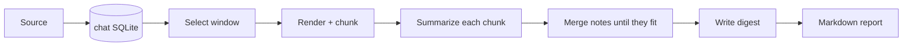

# tg-summary design

Summarize a Telegram group's history over a date range or the last N messages. Local models do the work.
Hosted models are optional. Chat text sent to them is redacted; media files and URLs are sent unchanged.

The output is a Markdown digest for members of the group. It has themes, decisions, open questions, action
items and links. Every point links back to the messages it came from.

## Where the data comes from

The pipeline never reads Telegram's local app storage:

- **Telegram Desktop** (Qt) keeps no message history on disk. `tdata` holds settings, keys and a media cache.
- **Telegram for macOS** (`ru.keepcoder.Telegram`) keeps a partial, SQLCipher-encrypted cache in an
  undocumented format under `~/Library/Group Containers/6N38VWS5BX.ru.keepcoder.Telegram/`. Parsing it means
  decrypting the account's local keys, and it can still have gaps.

One source is supported and one is planned. Both produce the same `Message` records (`models.py`) through
the `Source` interface (`sources/__init__.py`):

| Source | Status | Notes |
|---|---|---|
| Telegram Desktop single-chat JSON export | built (`sources/desktop_json.py`) | Open the group, choose ⋯ → Export chat history → JSON. A single-chat export contains everyone's messages. Supports date ranges in the export dialog. |
| Telegram API via Telethon | planned | Last N or a date range with no manual step. Needs `api_id`/`api_hash`. The session file is equivalent to account access. |

## Stages



1. **Ingest** (`tg-summary ingest`). Records go into one SQLite file per chat (`store.py`). Re-ingesting
   updates edited messages. A database refuses to take messages from a different chat.
2. **Select**. Regular messages in `[since, until)`, trimmed to the newest N. Service events (joins, pins)
   are counted in the report but not summarized.
3. **Render** (`segment.py`). Each message becomes one line: `#id date time Sender ↪#reply [fwd: X]: text`.
   - Media becomes a placeholder: `[photo]`, `[voice 0:12]`, `[file: x.pdf]`. Polls and stickers render as
     text.
   - A reply to a message outside the chunk gets a short quote of the original.
4. **Chunk**. The window is split recursively until every piece fits the token budget, then neighbouring
   pieces are packed together, so conversations stay whole and the number of calls stays low.
   - Each cut goes where the silence is longest, discounted by the replies that would cross it
     (score = silence ÷ (1 + crossing replies)). A slightly shorter silence that no reply crosses can win
     over a longer one in the middle of a reply chain.
   - Silences longer than `gap_minutes` are marked in the text.
   - The budget is `min(chunk_tokens, context_tokens − max_output_tokens − prompt overhead)`.
   - Tokens are estimated at 3.5 characters each, because there is no common way to ask a server for its
     tokenizer.
5. **Summarize each chunk** (`summarize.py`). Output is JSON `Notes`: topics, decisions, open questions,
   action items and links, each with `msg_ids`.
   - **Lists are capped** (`maxItems` in the schema: 12 topics, 6 each of decisions, open questions and
     action items, 8 links, 12 ids per topic, 8 per item; the digest has its own caps). A JSON-schema server
     enforces them while generating (Splash does); in prompt mode they are instructions, and code trims what's
     over and counts it. The prompts ask for the most important entries first and representative ids, not all.
     This keeps a chunk's notes near 4K output tokens.
   - **Notes that still don't fit** (output truncated, or unusable after the repair round) don't stop the
     run: the chunk is cut in two, in its middle half, at the quietest point that breaks the fewest reply
     chains, and each part is summarized. This repeats up to three levels deep. The truncated attempt is
     remembered in the cache, so a rerun goes straight to the parts.
6. **Merge**. While all the notes together exceed the budget, consecutive notes are merged in batches.
7. **Digest**. One call produces the overview, themes and lists.
   - Merges and the digest use the optional `digest` role when one is configured, and `summarize` otherwise.
     That lets the few late calls use a different model or reasoning setting from the many chunk calls.
8. **Report** (`report.py`). Citations link to `https://t.me/c/<chat>/<msg>` for private supergroups. A
   coverage appendix lists counts, media that was not processed, external calls and redactions.
   - **Sections:** overview, themes, decisions, open questions, action items and **Notable links** come from
     the digest: the summarizer's judgment, with checked citations.
   - **Bangers** (`[report] bangers`, default 5, minimum `bangers_min_reactions`, default 3): the most-reacted
     messages of the period, ranked by total reactions from the export (emoji, custom emoji and paid stars).
     Each line shows the counts, sender, an excerpt with any media description, and a link. No model is
     involved. Reactions are stored at ingest; an older database gets the column on open and the counts on the
     next ingest.
   - **Appendix: all media and links** (`[report] media_appendix`, on by default) lists every processed photo,
     video, voice note and link with its description, transcript or link summary and links to its messages.
     Links that couldn't be read show their error code. Unlike Notable links, it is complete, not curated.
   - Citation links are generated by the tool, never taken from model output.
   - Model text and chat-supplied text (such as the group name) are escaped, so they render as plain text.
     A model cannot add images, HTML, links, headings or lists.
   - URLs that appear in the summarized messages stay clickable. Any other URL is shown as a code span.
   - This matters because a Markdown viewer fetches images when the report opens. Without escaping, a
     response like `` would become a request carrying the restored name.

### Getting valid JSON

- With `structured = "json_schema"`, requests send `response_format: json_schema`. Every response is also
  validated with pydantic, so `"prompt"` mode works with servers that don't support it.
- Reasoning blocks (`<think>…</think>`) and code fences are stripped before parsing.
- Message ids that weren't in the input, and items with no valid citation, trigger one repair request.
  Whatever is still invalid after that is dropped and counted in the coverage appendix.

### Caching and long runs

Every completed call is cached in the chat database as soon as it finishes, after its repair round if it had
one (one SQLite transaction per call).
The key covers the endpoint, the model, its settings, the schema and the full message list, so changing a
prompt invalidates the cache on its own. Re-running the same command after a crash, a server failure or
Ctrl-C repeats no finished call. `tg-summary-eval compare` bypasses the cache for summarizing (it neither reads
nor writes it), because its repeats must be independent samples.

What keeps a long run going:

- **Server hiccups are retried** on model calls. Connection failures, timeouts, 5xx errors, "overloaded" and
  rate limits are retried after 10 s, 30 s, 1, 2 and 4 minutes (or the server's `retry-after`, if longer):
  about 8 minutes, enough for a local server to restart. Other errors (bad request, wrong model name) fail at
  once. Transcription requests are not retried within a run; a failed transcription is tried again next run.
- **One failed chunk doesn't stop the others.** Every chunk that can finish does, and is saved, before the run
  reports which chunks failed. The rerun only redoes those.
- **No idle sleep.** On macOS, `summarize`, `enrich`, `compare` and `judge` hold a `caffeinate -i` assertion
  for their lifetime. Closing the lid or a low battery still sleeps the machine.
- **Ctrl-C** while summarizing exits at once, without waiting for the request in flight, and says how to
  resume. During the media and link stage or judging, it may first wait for requests already in flight.
- **Comparisons** write their results file after every run (atomically). `compare --resume` keeps the
  finished runs in `--out` and runs the rest, including runs that failed because the server was down. It
  refuses a file whose input differs: other messages, or the same messages with different text (a
  re-ingested edit, new media or link descriptions; checked by a hash of every chunk's text, no text is
  stored), other chunking, or other judge or variant settings. Adding repeats is allowed.

## Model endpoints

Model calls go through [Pydantic AI](https://pydantic.dev/docs/ai/overview/), pinned to an exact version
(`llm.py`). It handles the wire formats, JSON output modes, the repair round, paused tool loops and
provider-specific response parsing. The project keeps the cache, redaction, request-scoped restoring and the
audit log. Two endpoint formats are configured:

- `api = "openai"`: `/chat/completions`, used by LM Studio, oMLX, llama-server, vLLM and most hosted providers.
- `api = "anthropic"`: `/messages`.

Two Pydantic AI defaults are overridden, because both broke on a local Qwen model (oMLX) in testing:

- **Our own format prompt** (`template=False`). The JSON schema and rules go in the system prompt.
  With the framework's default, the model dropped the brackets from 37 of 38 placeholders.
- **No `response_format` in `prompt` mode** (`supports_json_object_output=False`). The framework sends
  `json_object` by default, which let the server accept bare JSON arrays. `prompt` mode exists for servers
  whose `response_format` support can't be trusted, so it now sends none.

Calls run from worker threads (`concurrency` per role). Each call runs in its own short-lived event loop and
closes its HTTP connections before it returns. The work is network- and model-bound, so threads are enough.

**Reasoning models** can spend the whole output budget thinking before they answer. In testing, a 4B Qwen on
llama-server used more than 12,000 tokens without answering. Each role therefore has a `thinking` setting:

- Not set (the default): nothing is sent, and the server's own default applies. For Qwen that means thinking.
- `false` / `true`: off or on. A level (`"minimal"`, `"low"`, `"medium"`, `"high"`, `"xhigh"`, `"max"`)
  turns it on and also asks for that effort.
- When thinking is on, `thinking_tokens` (default 8192) is added to `max_output_tokens` for the request's
  `max_tokens`. This is extra headroom in one shared limit, not a reserved share for the answer: a model can
  still spend the whole enlarged limit reasoning. An independent reasoning cap applies only where one is sent
  and enforced: Anthropic models that accept a fixed `budget_tokens` get `thinking_tokens` as that cap;
  Claude 5.x (adaptive thinking) and local servers get none by default. On llama-server, a per-request
  `thinking_budget_tokens` in the role's `extra_body` did cap reasoning in testing. The chunk budget shrinks
  by the headroom.

How the setting reaches each server:

| Server | Off | On / level | Thinking cap | Verified |
|---|---|---|---|---|
| llama-server | `chat_template_kwargs.enable_thinking: false` | `enable_thinking: true` | `max_tokens` only. llama-server also honours a per-request `thinking_budget_tokens` in `extra_body`. | Qwen3.5-4B: thinking off 4 completion tokens, on 607 to 737; through the pipeline, on produced 4,437 to 5,784 characters of reasoning, off none. `thinking_budget_tokens = 64` cut reasoning to 197 characters. |
| oMLX | `enable_thinking: false` | `enable_thinking: true`; `reasoning_effort` is passed through | `max_tokens` only | Qwen3.8-27B: off 0 reasoning tokens, on 96 to 157. **With `structured = "json_schema"` oMLX did not think at all**, even with thinking on; use `"prompt"` mode to compare thinking. `reasoning_effort` low / medium / xhigh / none gave 1,182 / 1,565 / 1,994 / 1,318 reasoning tokens in single samples, so no clear effect yet. |
| LM Studio | `reasoning_effort: "none"` (it ignores `chat_template_kwargs`) | its default | `max_tokens` only | Qwen3.5-4B: `enable_thinking: false` alone still reasoned 1,832 tokens; `reasoning_effort: "none"` gave 0. `false` therefore sends both fields. |
| Anthropic | unified Pydantic AI `thinking` setting | same; levels map to effort | Claude 5.x thinks adaptively (no fixed budget accepted). Older models get `budget_tokens = thinking_tokens`. | Not verified live yet. |

The role's `extra_body` is merged over these fields, so a server that needs something else can be given it.
`chat_template_kwargs` is merged key by key. `temperature`, `top_p`, `top_k` and `presence_penalty` can be set
per role, and `"default"` sends none. Qwen recommends different sampling for each mode (thinking: temperature
1.0, top_p 0.95, top_k 20, presence_penalty 0; non-thinking: 0.7, 0.8, 20, 1.5). Claude 5.x rejects
non-default sampling; Pydantic AI drops `temperature` for those models with a warning.

The recommended starting point is thinking off for `summarize`. This is **provisional**: it rests on the
runaway-thinking failures above and on published results that thinking does not improve faithful
summarizing. Confirm it with `tg-summary-eval compare` (see [Comparing reasoning settings](#comparing-reasoning-settings))
before relying on it. When the output budget runs out on a chunk, the chunk is summarized in parts (see
[Stages](#stages)); when it runs out on a merge or the digest, the run stops with a message saying so.

Verified on Pydantic AI 2.66: oMLX (Qwen3.8-27B), LM Studio (Qwen3.5-4B) and llama-server (Qwen3.5-4B,
reasoning off), each in both `json_schema` and `prompt` modes; Anthropic (Haiku) with web fetch.

Each endpoint states its trust level. Routing never guesses it from the URL:

- `private` may see raw chat text. Use it for your own machine or your own inference server.
- `external` only receives redacted chat text. If redaction cannot run (for example, Presidio fails to load),
  the run fails rather than sending anything. Media files are a separate decision; see
  [What hosted jobs receive](#what-hosted-jobs-receive).

The tool adds no `tools` to roles that see the conversation. Keep it that way in your own config: a role's
`extra_body` is passed through unchanged, and a local server can be set up to run tools on its own (LM Studio
supports MCP). The one role that uses tools is `read_link`, which sees a single URL and its message, never the
conversation.

Chat text is presented as data, and the prompts say to ignore any instructions inside it. With no tools
enabled, a message that tries to steer the model can at most skew a summary. It cannot trigger an action, and
it can't use the report to make a request, because model text is rendered inert (see stage 8). One gap remains: some
Markdown viewers turn bare domain names like `example.com` into links. Those still need a click; nothing is
fetched automatically.

## Comparing reasoning settings

`tg-summary-eval compare` runs one window several ways and reports metrics side by side. Evaluation commands
live in `tg-summary-eval`, separate from the main `tg-summary` CLI:

```sh
tg-summary-eval compare --db chat.sqlite --config config.toml --variants variants.toml --last 2000 --repeats 3 --out results.json
```

- **Variants** (`compare.py`) override fields of the `summarize` and/or `digest` roles (see
  `variants.example.toml`). Without a configured `digest` role, a variant's digest starts from that variant's
  summarize settings, as in a normal run. A variant may also set `model`, or `endpoint` to another configured
  endpoint, to compare models or servers; the header names any variant that sends redacted text to an
  `external` endpoint. Variants alternate within each repeat, so a server that can't keep every model loaded
  will reload between runs; the wall-time column includes that.
- **Same input for every variant.** The chunk budget is the smallest any variant allows, so every variant
  sees the same chunks even though thinking headroom shrinks the room. Media and link text comes only from
  results already stored by `tg-summary enrich` or a normal run; a comparison never runs that stage, so it
  sends nothing for media and links and stores nothing.
- **Independent repeats.** Summarizing bypasses the response cache. Variants alternate within each repeat,
  so changes in server load spread across all of them.
- **Per run**, `results.json` records: status (`ok`, `truncated` with the stage that ran out, or `error` with
  only its kind), wall time, per stage (chunk notes vs merge + digest) calls, input and output tokens,
  reasoning tokens where the server reports them, reasoning characters returned, repairs and retries after
  server errors, plus chunk splits (notes too long), invalid citations dropped, uncited items dropped, list
  entries trimmed to a cap, digest length in characters, and counts of themes and items.
- **Interrupted comparisons** resume with `--resume` (see [Caching and long runs](#caching-and-long-runs)).
- **Claim checks.** With a `judge` role, every theme summary, key point, decision and action item is checked
  against the messages it cites: supported, partially supported or unsupported. Rates leave out failed judge
  calls. The judge reads the cited messages unredacted, so the command refuses a judge on an `external`
  endpoint. Judge verdicts are cached, since the same claim and messages get the same check.
- **Judging later, for one model in memory at a time.** Every successful run's digest is saved in the chat
  database under a `run_id`, together with the exact judge prompts: each claim with its cited messages and
  their media and link text as that run saw them. The JSON gets the `run_id` and a fingerprint of the window
  (counts, first and last message id, a hash of the ids; no text). To compare models that can't be loaded
  together:
  1. Run `tg-summary-eval compare --no-judge` once per model, on the same window, with only that model loaded.
  2. Load the judge model and run `tg-summary-eval judge --db chat.sqlite --config config.toml --results a.json --results b.json --out both.json`.

  It grades every run on its saved prompts, never on current messages or config. A re-ingested edit, a
  changed link rule or removed media roles in between therefore can't change a verdict. Inline judging
  grades the same prompts. One table covers all the files. Files from different windows, or that reuse a
  variant name, are refused. Runs saved without prompts stay unjudged.
- **Output is metrics only.** The printed Markdown table shows each variant's mean ± sample standard
  deviation over its successful runs. Neither the table nor the JSON contains message text or model text,
  so the command can run on a real chat.

On oMLX, use `structured = "prompt"` for these runs: under `json_schema` it does not think at all (see
[Model endpoints](#model-endpoints)), so thinking variants would silently match the non-thinking ones.

## Jobs and roles

Local and hosted models are not two copies of one pipeline. Each job is a **role**, and each role points at
whichever endpoint suits it. The endpoint's trust level then decides what the role is allowed to see.

| Role | Job | Typical endpoint | Input |
|---|---|---|---|
| `summarize` (built) | Chunk notes; also merges and the digest when there is no `digest` role | local | The conversation |
| `digest` (built, optional) | Merges and the final digest | local | Notes about the conversation |
| `judge` (built, optional) | `tg-summary-eval` claim checks | local; `private` only | One claim plus the messages it cites |
| `transcribe` (built) | Voice notes, video notes, audio from videos | local (any `/v1/audio/transcriptions` server; see below) | One audio file |
| `describe_media` (built) | Photos, screenshots, GIFs, videos, image/PDF documents | hosted vision model | One media item plus its message text |
| `read_link` (built) | Articles, blog posts, GitHub, X posts, linked videos | hosted model with web tools | One URL plus its message text |
| `embed` (planned) | Theme clustering for very large windows | local `/v1/embeddings` | Topic summaries |

Media and links become text before summarizing (`enrich.py`, also runnable alone as `tg-summary enrich`). It
runs `transcribe`, `describe_media` and `read_link` between select and render. Each result is attached to its
message, so the summarizer sees for example `[photo: screenshot of a GitHub issue about …]`,
`[voice 0:12: transcript "…"]` or `[link: github.com/x/y — README of …]` next to the message text. The
summarizer itself never changes. `preview-redaction` only reuses stored results and sends nothing.

- **Routing** (`[media]` in config): each kind (`photo`, `video`, `animation`, `video_message`, `voice`,
  `audio`, `document`, `sticker`) is `describe`, `transcribe` or `skip`. Defaults: photos, videos and GIFs are
  described; voice and video notes are transcribed; audio files, documents and stickers are skipped.
  With `describe`, a document or sticker is sent only if it is a JPEG, PNG, GIF or WebP image or a video
  (animated stickers included); a document also if it is a PDF. Anything else keeps its placeholder.
- **Files** are found at `Media.path` under the `media_root` stored at ingest. A file missing from the export
  keeps its placeholder and is counted as `missing`.
- **Only files inside the export are ever read.** Ingest drops paths that could leave it (absolute, `..`,
  backslashes, drive letters). Before any read, hash or upload, the stage resolves the media root and the
  file, following symlinks, and refuses anything outside the root; refused files count as `missing`. Both
  checks apply, so a crafted export or an older database can't get an arbitrary local file sent to a model.
- **Storage**: the `derivations` table holds one row per item and role: status, derived text, model, a
  fingerprint of endpoint, model and prompt, an error code and, for links, the fetch evidence. The
  `message_items` table maps message ids to items. Rows with status `done`, `opened` or `unverified` are reused
  while the fingerprint matches, and so are permanent link failures (below). Other `failed` rows and
  `over_limit` rows are retried on the next run.
- **Transcription** sends 16 kHz mono WAV (converted with ffmpeg) to `{base_url}/audio/transcriptions`. Tested
  local options:
  - **oMLX** with `parakeet-ultra-nounk-mlx`: correct transcript of a synthetic 5-second clip in 2.3 s, through
    the stage as well. Some of oMLX's other speech models did not load (kyutai `stt-1b-en_fr`, `stt-2.6b-en`:
    "Model type stt not supported").
  - **mlx-audio's server**, `uvx --python 3.12 --from 'mlx-audio[server]' mlx_audio.server --port 8094`, with
    `mlx-community/parakeet-tdt-0.6b-v3` (0.3 s warm). whisper.cpp's server also works with WAV.

  External transcription calls are audited with the form fields and the file size in place of the bytes.
- **Coverage**: the report counts items by kind and status (`done`, `opened`, `unverified`, `failed`,
  `over_limit`, `missing`, `skipped`) and lists failure codes.

### What hosted jobs receive

- **One item at a time, never the conversation.** A hosted `describe_media` or `read_link` call gets a single
  photo, video or URL, plus the text of the message it came with. It never sees the surrounding chat, who
  replied, or what the group concluded.
- **Message text is still redacted** when the endpoint is `external`, using the same redactor as summarizing.
- **Media files are sent as-is.** The tool does no image, audio or video redaction, and none is planned.
  Make sure the group is fine with that before sending its media to a hosted model. To keep media local, set
  the media kinds to `skip`, or keep both `describe_media` and `transcribe` on `private` endpoints or
  unconfigured: an external `transcribe` role receives voice notes and audio too.
- **Links go to the provider as-is.** Two kinds are skipped because nobody outside the group can open them:
  private message links (`t.me/c/...`) and invite links (`t.me/+...`, `t.me/joinchat/...`).

### Videos

- **Provider accepts video input** (Pydantic AI's model profile says so): send the file directly.
- **Provider takes images only:** transcribe the audio with `transcribe`, then send `media.frames` key frames
  (default 4, extracted with ffmpeg) plus the transcript to `describe_media`. This works with any vision model,
  and it is always the path for the two configured formats: neither chat completions nor the Anthropic
  Messages API takes video. The transcript is treated as part of the media and is not redacted.
- **Linked public videos** (YouTube and similar) go to `read_link` as URLs, since some providers can open them
  directly.
- **Videos missing from the export:** Telegram Desktop skips files over the size limit set in its export
  dialog. They stay as placeholders and are counted in the report.

### Links via provider tools

The project does not fetch web pages itself. `read_link` relies on the provider's own server-side browsing,
and every provider turns that on differently:

- Anthropic: server tools in the Messages API's `tools` list.
- OpenAI: search models in chat completions, or tools in the separate Responses API.
- OpenRouter: web search on top of chat completions.
- Gemini: its own tool settings.

Instead of encoding each one, a role can carry `extra_body` (merged into the request) and `extra_headers`.
Whatever the provider documents goes there:

```toml
[roles.read_link]
endpoint = "claude"
model = "..."
# Illustrative; tool versions change, so copy the current name from your provider's docs.
extra_body = { tools = [{ type = "web_fetch_20260318", name = "web_fetch", max_uses = 3 }] }
# extra_headers = { ... }   # only if the provider requires one, e.g. a beta flag
max_calls = 200
```

Rules for this role:

- **Only tools the provider runs itself.** The project never runs a tool loop on this machine. As a result,
  posted links can't reach your LAN or local servers; only the provider's infrastructure fetches them. If a
  response asks this machine to run a tool, the item fails.
- **The URL goes in the user message.** Some providers refuse to fetch URLs that appear only in the system
  prompt (Anthropic's web fetch does).
- **Pages are untrusted.** The prompt treats page content as data. The result is a short description that
  then passes through the same inert report rendering as every other model output.
- **Per-site rules** (`[links] rules`, by domain; subdomains included, the longest match wins, `*` is the
  default):
  - `read` (default): up to 3 fetches, page text capped at `page_tokens`, one to three sentences.
  - `brief`: one fetch, page text capped at `brief_page_tokens`, one sentence naming title, author or channel
    and topic. YouTube links in `brief` mode ask the provider to fetch YouTube's public oEmbed URL, which
    returns title and channel as JSON; the video page's own text is nearly empty. Nothing is transcribed.
    Verified live with Claude Haiku 5.5: opened, and the one sentence named the exact title and channel.
  - `skip`: never sent; counted as skipped with reason `rule`.

  Defaults: YouTube is `brief`, everything else `read`. The mode is part of a result's fingerprint, so
  changing a rule re-reads affected links on the next run. The fetch and page-size limits apply when the tool
  sets up Anthropic's web fetch itself; a `tools` list in the role's `extra_body` replaces that setup, limits
  included.
- **Failures are expected.** Some sites block automated readers. Anthropic's fetch tool refuses x.com outright
  (`url_not_allowed` in a live test), so `x.com = "skip"` saves that call. Links that couldn't be opened get
  no note (the message keeps its URL) and are counted in the report.
- **A third request format, OpenAI's Responses API, is not planned.** Providers reachable through chat
  completions or the Anthropic format cover this job. Add it only if a needed provider has no other way in.

#### Reading the response

Pass-through fields cover the request side only. A browsing response carries more than text. Pydantic AI
parses it into message parts: text, the provider's tool calls (`NativeToolCallPart`) and their results
(`NativeToolReturnPart`).

What the framework already handles (verified on version 2.66 with a live Anthropic call and with mocked
responses shaped after Anthropic's docs):

- **Paused tool loops.** `stop_reason: "pause_turn"` is continued automatically by resending the paused
  assistant blocks, and the segments are merged into one response. (Verified with mocked responses; the live
  call finished without pausing.)
- **Tool calls and results** are paired and exposed as parts, including the raw result content.
- **Truncation** shows up as `finish_reason == "length"`. `summarize` turns that into a `truncated` error
  instead of a confusing JSON error, and splits chunk notes that hit it.

Checks of our own (in `links.py`):

- **Failed fetches are labelled `outcome="success"`.** The real status is only in the raw content: a
  `web_fetch_tool_result_error` with an `error_code`. In a live call, an X post came back as
  `url_not_allowed` (Anthropic's fetch tool refuses x.com), while a GitHub page opened normally. The link
  status therefore comes from the raw content type, not from `outcome`.
- **Fetches before a pause.** After `pause_turn`, Pydantic AI 2.66 keeps only the final segment's parts, so a
  fetch made before the pause is missing from the parts (seen with mocked responses). Evidence is therefore
  also read from the raw Anthropic response bodies the audit recorder keeps.
- **Citations.** With `enable_citations`, the raw response does carry `char_location` citations on text
  blocks (live, Haiku, Wikipedia page), but Pydantic AI 2.66 merges the text blocks into one part and drops
  them. They are counted from the raw bodies and stored with the evidence. Requesting citations also makes
  Pydantic AI send `allowed_callers: ["direct"]`, so the fetch is a direct tool call whose result is visible,
  not one hidden inside server-side code execution.

For `api = "anthropic"` without `tools` in `extra_body`, `read_link` adds Pydantic AI's
`WebFetchTool(max_uses=3, enable_citations=True)`. Other endpoints need their provider's tools in
`extra_body`; without any, the model only sees the URL and its answer is `unverified` at best.

Whether a link was opened is decided from this evidence, not from the model's own claim:

| Evidence | Status |
|---|---|
| At least one successful fetch of the URL | `opened` |
| Fetches recorded, all failed | `failed`, with the error code in the report, whatever the text says |
| No fetch evidence (providers that don't report tool calls), but citations or a description returned | `unverified`, shown as such in the report |

The cache stores the result only after the turn finishes. Truncated items, and links whose fetch failed for a
reason that may pass, are not cached as final, so a later run retries them. Failures the provider will repeat
for the same URL are final: `url_not_allowed` (x.com), `url_too_long`, `invalid_tool_input` and
`content_too_large`. They cost one call, not one per run. Transient codes (`url_not_accessible`,
`too_many_requests`, `unavailable`, `max_uses_exceeded`) are retried, and so is `url_not_in_prior_context`:
the URL is always in the user message, so that error should not recur. A different endpoint, model, prompt or
`extra_body` changes the fingerprint, which retries every failure.

### Cost limits

- The `transcribe`, `describe_media` and `read_link` roles each take an optional `max_calls`: the most items
  that role processes per run. Items beyond it keep their placeholder and are counted in the report. It
  counts items, not requests (a retried item can make more than one), and it doesn't limit summarizing or
  judging.
- Results are cached by file hash (media) and by URL (links). An image reposted 20 times, or a link shared
  across runs, costs one call.

## Redaction (`redact.py`)

Redaction applies to all chat text sent to an `external` endpoint: whole chunks for `summarize`, and the
accompanying message text for hosted media and link jobs. Media files themselves are sent as-is. The system
prompt contains no chat content and is sent as written.

### Detectors

Listed in priority order. Overlapping spans, whether they cross or one contains another, merge into one
placeholder that covers all of them, so nothing any detector flagged is sent. The placeholder takes its kind
from the strongest span: escaped look-alikes first, then member names, rules and known values (which share a
priority), then the statistical detectors (Presidio and, if enabled, PII-Tracer), and the longer span among
equals. It restores the exact covered text, or the strongest span's canonical value (such as the full name
behind a first name) when the two cover the same text.

1. **Escaped look-alikes.** Text in the source that already looks like a placeholder becomes `[LITERAL_n]`
   and is restored verbatim. That covers bracketed text (`[PERSON_3]`) and bare text (`PERSON_3`) for every
   kind the request can emit: the built-in kinds plus any configured entity detected in that request, such
   as `US_SSN`. Ordinary identifiers such as `HTTP_2` are left alone.
2. **Member names.** A list of every sender and forwarded-from name. Each name matches in full, as its words
   joined by spaces, and as its first name alone when that first name is unique in the group and at least 3
   characters long.
   - Matching ignores case. Over-redacting is the safe failure, and `redaction.allow` handles false positives.
3. **Rules** for URLs, email addresses and `@handles`.
4. **Known values.** Every value already in the vault is matched exactly wherever it appears. Presidio's
   detection depends on context: in testing it caught a place name in a chat line but missed the same name
   inside the JSON notes sent to the digest call. A false positive stays redacted until added to
   `redaction.allow`.
5. **Presidio** with spaCy `en_core_web_md`: people, places, phone numbers, emails, IP addresses, card
   numbers, IBANs and URLs. The score threshold defaults to 0.35, because Presidio scores phone numbers with
   no nearby context words at 0.4. On by default (`redaction.detectors`).
6. **PII-Tracer** (optional; install a runtime, then add `"pii_tracer"` to `redaction.detectors`): a 0.6B
   Qwen3 encoder from Perplexity trained on multilingual assistant conversations (MIT,
   [paper](https://arxiv.org/abs/2609.22200)). It tags people (including lowercase names and @handles),
   emails, phones, private addresses, private URLs, dates, account numbers, secrets and other PII; plain dates
   are left out by default because summaries need them. Its labels target private information, not public
   places or products, so it mostly leaves those alone, but false positives still happen: in a synthetic test
   it tagged "winamp" as a person when that message stood alone.
   - `pii_tracer.py` loads the weights from a pinned revision of the Hugging Face repo and re-implements its
     small inference code (bidirectional encoder, token head, constrained BIOES Viterbi in numpy) instead of
     running the repo's code. Checked against the reference: identical token ids and spans, logits within 3e-6.
   - Two runtimes share the tokenizer, windows, decoder and weights; only the encoder differs.
     `redaction.pii_tracer_runtime = "auto"` uses MLX when it is installed on Apple Silicon, PyTorch otherwise.
     - **MLX** (`uv sync --extra pii-mlx`, about 235 MB): the Qwen3 encoder written directly in MLX.
     - **PyTorch** (`uv sync --extra pii`, about 800 MB): transformers' Qwen3Model run bidirectionally, on the
       Apple GPU, CUDA or the CPU.
     - On synthetic chat both give identical spans. Their logits differ by as much as PyTorch's own GPU and CPU
       kernels differ from each other (mean 0.016 against 0.015). A test runs a tiny random model through both
       in fp32 and requires agreement within 1e-3, which catches structural mistakes such as the wrong RoPE layout.
   - Text goes in windows of whole lines up to 3,500 tokens (the model reads 4,096 and is weaker on very short
     inputs). Each window is recounted with the real tokenizer (its built-in truncation switched off) and
     halved until it fits, so dense text such as CJK or code is never cut off unread. Every span is widened to
     whole words, so a cut-short span ("ave" of "dave") hides the whole word.
   - Speed, measured on an M2 Max with about 170 synthetic chat lines joined: MLX about 5.5 ms per message,
     PyTorch on the Apple GPU about 12 ms, PyTorch on the CPU about 130 ms. A whole `preview-redaction` run of
     the small synthetic chat took about 2 s on MLX and about 16 s on PyTorch, mostly loading the model.

### Two lookups

- **The vault** (`vault` table) is kept per chat, across runs. It gives each `(kind, normalized value)` a
  stable number, so `[PERSON_3]` means the same person in every request and every run. It is never used to
  restore text.
- **The request map** is built per hosted request. It holds only the placeholders emitted into that request,
  plus escaped look-alike text.

### Restoring placeholders

- One regex pass over each string of the parsed response, looked up in the request map only.
- Models sometimes drop the brackets (5 of 39 placeholders in one local run). A bare `PERSON_1` is restored
  only if `[PERSON_1]` was sent in this request; ordinary identifiers like `COVID_19` are untouched.
- Restored text is never scanned again, and whole-token matching keeps `[PERSON_1]` from matching inside
  `[PERSON_10]`.
- A placeholder not in the request map is left as written and listed in the report. That covers placeholders
  the model invented, and real vault entries that weren't part of this request.
- Restoring happens after JSON parsing, so restored quotes can't break the JSON.

### Audit and preview

- Every completed external exchange is written to the `audit` table: the exact HTTP request and response
  bodies (including error responses), and any unmatched placeholders. A request that fails in transport, for
  example by timing out after it was sent, can be missing. Transcription records metadata, not the exact
  multipart body.
- `tg-summary preview-redaction` sends nothing. It writes two kinds of section:
  - **Summary chunks,** redacted as an `external` summarize endpoint would get them. Merge and digest
    requests carry model-written notes, not chat lines, and are not previewed.
  - **Hosted media and link requests,** one per item a run would send: the user message built by the same
    code, with that item's message text redacted on its own as the run does, plus a description of the
    attachments that go as-is. Items already stored and items over `max_calls` are left out, as in a run.
    Video frames are described by the configured maximum; the run attaches however many it extracts.

  A separate preview per item is needed because detection depends on context: redacting a whole chunk can
  find different things than redacting one message.

### What redaction does not cover

Combinations of ordinary details (a job, a neighbourhood, an event) can still identify someone. The report
says so whenever external calls were made.

## Planned

| Item | Shape |
|---|---|
| Per-domain link rewrites | Rewrite a domain that refuses fetches (x.com) to a public mirror before `read_link`. |
| Telethon source | Implements `Source`. `iter_messages(limit=N)` or `offset_date` windows; later runs fetch only messages newer than the highest stored id; media downloaded on demand. |
| Theme clustering | `embed` role: embed topic summaries and cluster them before the digest, for windows too large for merging alone. |
