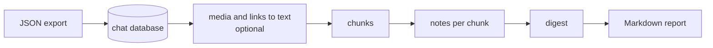

# tg-summary

tg-summary turns a Telegram group's history into a Markdown digest: the main themes, decisions, open
questions, action items and shared links for a date range or the last N messages. Every point cites the
messages it came from. Local language models do the summarizing. Hosted models are optional; chat text sent
to them is redacted first, but media files and URLs are not (see [Privacy](#privacy)).

## Status

This is an early personal project. It was built and used on one Apple Silicon Mac, with local models served
by oMLX and LM Studio. Any server with an OpenAI-compatible API should work, but expect to tune settings and
hit rough edges on other setups. Summary quality depends mostly on the model you run.

## How it works



1. **Ingest.** Telegram Desktop exports a chat as JSON. `tg-summary ingest` loads it into a SQLite database,
   one per chat.
2. **Media and links (optional).** Photos, videos, voice notes and shared links can become text first:
   descriptions, transcripts and one-line link summaries, from whichever models you configure.
3. **Chunk.** The messages in the window are split into pieces that fit the model's context. Cuts go at quiet
   periods and avoid breaking reply chains.
4. **Notes.** The model writes structured notes for each chunk: topics, decisions, open questions, action
   items and links, each citing message numbers. Citations to messages outside the chunk are dropped.
5. **Digest.** Notes are merged until they fit one request, then the model writes the digest.
6. **Report.** The digest becomes Markdown. For private supergroups, citations are links that open the
   message in Telegram. The report also lists the most-reacted messages, an appendix of every processed
   photo, video, voice note and link, and a table of what was processed.

Each model response is saved in the chat database as it arrives. If a run stops partway, running the same
command again picks up where it left off.

## Privacy

Every model endpoint in the config is either `private` or `external`:

- A `private` endpoint (your own machine or network) receives everything as it is.
- An `external` endpoint gets chat text redacted: names, phone numbers, email addresses and similar details
  become placeholders such as `[PERSON_1]`, and the tool puts the originals back in the reply.

Redaction covers chat text only. Media and links that you send to an external endpoint go unchanged:

- **Media.** A hosted media model gets the photo, video or audio file itself. For a video, it may also get
  the transcript of the video's audio.
- **Links.** A hosted link reader gets the full URL, which can itself identify people or private pages.
  Private Telegram message links and invite links are never sent, and you can skip other sites in the config.
  The provider's own browsing tool opens the page; this tool never fetches pages itself.

Redaction uses [Presidio](https://microsoft.github.io/presidio/), an English spaCy model and the chat's
member list. Optionally, it also uses [PII-Tracer](https://huggingface.co/perplexity-ai/PII-Tracer), a small
local model trained on conversations (`uv sync --extra pii`, then `detectors = ["presidio", "pii_tracer"]` in
the config). It will miss things, and a mix of ordinary details can still identify someone.
`tg-summary preview-redaction` writes the redacted chunk text and media and link requests a run would send,
without sending anything, so you can check them. It doesn't show merge and digest requests, which carry
model-written notes rather than chat lines, so it's a spot check, not a complete record. The database logs
each completed external request; one that fails in transit (for example a timeout) can be missing.

## Requirements

- Python 3.12 and [uv](https://docs.astral.sh/uv/).
- A local model server with an OpenAI-compatible API, such as LM Studio, llama-server (llama.cpp), oMLX or
  vLLM. The model needs a context of at least 32K tokens and should follow JSON schemas reliably.
  Development used Qwen models of 27B to 35B parameters.
- Optional, for media and links:
  - an Anthropic API key for describing images and reading links (other providers need extra config);
  - `ffmpeg` for voice notes and videos;
  - a speech-to-text server with an OpenAI-style `/v1/audio/transcriptions` endpoint.
- Optional, for stronger redaction: PII-Tracer (`uv sync --extra pii` installs PyTorch, about 800 MB, and the
  first run downloads about 1.2 GB of weights).

## Getting started

Install:

```sh
git clone <this repository> tg-summary
cd tg-summary
uv sync
```

Export the chat. In Telegram Desktop, open the group, choose **Export chat history** from the menu, and set
the format to **Machine-readable JSON**. Include photos, videos or voice messages only if you plan to process
them.

Load the export:

```sh
uv run tg-summary ingest "path/to/ChatExport_2026-01-01"
```

The database goes to `data/chat-<chat id>.sqlite` unless you pass `--db`. Ingest a newer export into the same
database later to add messages and pick up edits.

Configure a model:

```sh
cp config.example.toml config.toml
```

In `config.toml`, point `[roles.summarize]` at your server and model, and set `context_tokens` to what the
server accepts. Leave the media and link roles commented out to start.

Summarize a week, or the newest 500 messages:

```sh
uv run tg-summary summarize --db data/chat-<chat id>.sqlite --since 2026-01-01 --until 2026-01-08 --out reports/week.md
uv run tg-summary summarize --db data/chat-<chat id>.sqlite --last 500 --out reports/latest.md
```

On the Mac this was developed on, about 500 messages took 20 minutes with a 27B model. Windows of thousands of
messages take hours.

## Commands

| Command | What it does |
|---|---|
| `tg-summary ingest EXPORT` | Load a JSON export into the chat database |
| `tg-summary summarize` | Write the digest for a window (`--since`, `--until`, `--last`) |
| `tg-summary enrich` | Run only the media and link step |
| `tg-summary preview-redaction` | Write the redacted chunks and media and link requests a run would send, without sending anything (not merge or digest requests) |
| `tg-summary-eval compare` | Run several model settings on the same window and compare metrics (development tool) |
| `tg-summary-eval judge` | Check digest claims against the messages they cite (development tool) |

## Configuration

`config.example.toml` explains every setting. The main ideas:

- **Endpoints** say where a model runs and whether it is `private` or `external`.
- **Roles** are the jobs: `summarize` (chunk notes), `digest` (optional, merging and the final digest),
  `transcribe`, `describe_media`, `read_link` and `judge`. Each role names an endpoint and a model, so you can
  keep summarizing local and send only media to a hosted model.
- **Reasoning** is off for summarizing by default. Reasoning models can spend the whole output limit thinking
  and return nothing.

## Limitations

- The only input is a Telegram Desktop JSON export. There is no live connection to Telegram yet.
- Long windows (thousands of messages) take a long time on local hardware, and their digests get vaguer.
- Summaries can be wrong. Check claims against the cited messages before relying on them.
- Redaction is tuned for English.

## More

- [DESIGN.md](DESIGN.md) covers each stage, the privacy rules and the evaluation tools in detail.

## License

[MIT](LICENSE)
